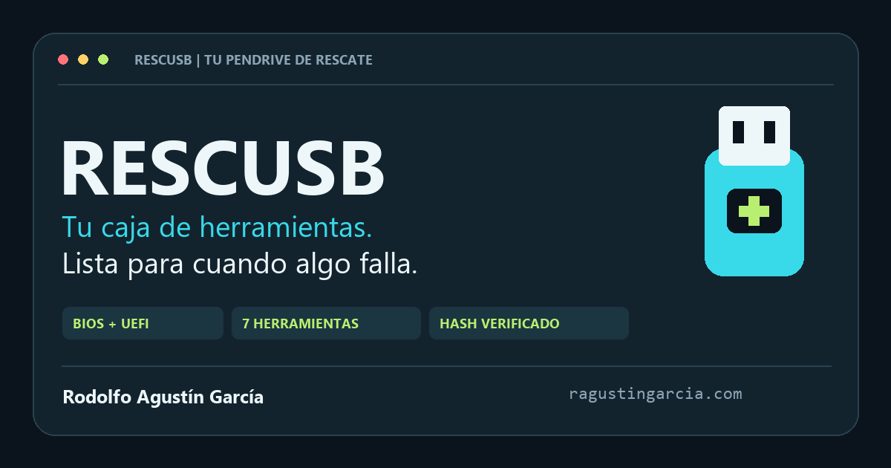

# RESCUSB

**Tu pendrive de rescate. Preparado para cuando algo falla.**

RESCUSB convierte un pendrive de 64 GB en una caja de herramientas de rescate: instala Ventoy, obtiene las imágenes oficiales, descarga o copia lo necesario y verifica cada archivo. Todo se maneja desde una sola ventana de terminal.

## Empezar

1. Descargá RESCUSB desde [GitHub](https://github.com/ragustingarcia/RESCUSB) (**Code → Download ZIP**) y descomprimilo en una carpeta del disco del PC. No ejecutes el programa desde el pendrive que vas a preparar.
2. Conectá el pendrive y abrí **INICIAR.bat**. Aceptá el permiso de administrador de Windows si aparece.
3. Elegí **Armar mi pendrive completo**. La opción predeterminada incluye seis herramientas; Windows 10 se agrega desde **Ajustes** porque ya no tiene soporte de Microsoft.
4. Elegí tu pendrive en la lista. Los discos internos y los discos USB fijos no se ofrecen. **Dejalo conectado** durante todo el proceso.
5. RESCUSB comprueba las fuentes oficiales. Para Windows abre la herramienta oficial de Microsoft y te guía para crear la ISO: **tarda de 20 minutos a más de una hora**. Todavía no se borra el USB. Si preferís, preparás ahora lo demás y agregás Windows después con **Continuar**.
6. Revisá el modelo, la capacidad, la unidad y la serie. Para autorizar el borrado, escribí **BORRAR seguido de la serie** que muestra el programa.
7. Esperá mientras se instala Ventoy y se descargan/verifican las imágenes directamente en el USB. Si se interrumpe, elegí **Continuar** la próxima vez.
8. Cuando aparezca **LISTO**, expulsá el pendrive desde Windows. Al reiniciar el equipo, elegilo desde el menú de arranque.

La preparación elimina todas las particiones y archivos del pendrive elegido. La consulta de fuentes ocurre antes de ese borrado. Si una fuente necesaria no está disponible, RESCUSB conserva el USB, explica qué falta y te deja elegir: preparar ahora lo disponible, descargar la ISO de Windows desde el navegador o volver al menú. Nunca presenta un resultado incompleto como terminado.

## El menú

| Opción | Para qué sirve |
|---|---|
| **Armar mi pendrive completo** | Primera preparación. Comprueba fuentes, solicita confirmación, instala Ventoy y prepara el contenido. |
| **Continuar o completar mi pendrive** | Reconoce un USB creado por este programa, conserva Ventoy y retoma/completa descargas. |
| **Comprobar que todo esté disponible** | Consulta el USB y las fuentes, y busca una ISO de Windows ya creada. No borra ni instala. |
| **Ajustes y contenido** | Cambia el idioma de Windows o elige herramientas con números. Todas vienen seleccionadas por defecto. |
| **Qué hace RESCUSB** | Explica las herramientas y cómo arrancar el pendrive, dentro de la misma terminal. |

El BAT abre PowerShell automáticamente. Si necesita elevar permisos, cierra la ventana de inicio y deja una sola ventana de trabajo. El aviso de seguridad de Windows pertenece al sistema y no se suprime. Si ya se inició como administrador, se usa la misma ventana.

## Qué queda en el USB

| Herramienta | Uso principal |
|---|---|
| SystemRescue | Recuperar archivos y reparar particiones. |
| Memtest86+ | Comprobar la memoria RAM. |
| Hiren's BootCD PE | Herramientas de reparación en un entorno Windows PE. |
| Rescuezilla | Crear y restaurar copias de discos. |
| Ubuntu Desktop Live | Usar Linux sin instalarlo y acceder a archivos. |
| Windows 11 x64 | Reparar o reinstalar Windows 11. |
| Windows 10 x64 | Reparar o reinstalar Windows 10. |

Windows viene configurado en **español y x64**. En Ajustes podés elegir español de Latinoamérica o inglés. Las imágenes de Windows son de consumo y multiedición; no son versiones Enterprise de evaluación ni un Windows portátil. La activación/licencia del equipo sigue siendo independiente de RESCUSB.

Windows 10 dejó de recibir soporte de Microsoft el 14/10/2025. Sigue disponible en **Ajustes → Elegir herramientas**, pero no viene marcado por defecto.

## Windows con la herramienta oficial de Microsoft

Microsoft no ofrece la ISO de Windows por descarga directa a programas: a un navegador de Windows lo manda a su **herramienta de creación de medios**. RESCUSB usa siempre ese camino oficial y **avisa antes que tarda de 20 minutos a más de una hora** según la conexión (la herramienta descarga unos 7 GB). El pendrive no se toca mientras tanto.

1. Antes de borrar nada, RESCUSB busca una ISO de Windows ya creada en **Descargas** e **ISO-OFICIALES**. Si encuentra una válida, la usa y se saltea la herramienta.
2. Si no hay, ofrece **Crear la ISO de Windows ahora** (también con Enter). Descarga la herramienta de `go.microsoft.com` y solo la abre si tiene firma digital válida de Microsoft Corporation.
3. Te guía en la herramienta: idioma, x64 y **Archivo ISO** guardado en Descargas. Nunca hay que elegir «Unidad flash USB», que borraría el pendrive.
4. Cuando la cerrás, RESCUSB monta la ISO en solo lectura y comprueba dos cosas:
   - que `setup.exe` y `sources\setup.exe` tengan firma válida de Microsoft;
   - con DISM, que la imagen sea x64, del idioma elegido y de la versión correcta (Windows 11 = compilación 22000 o posterior).
5. La copia al pendrive verificando su SHA-256 propio. El informe la marca como **verificada por firma**.

Si en Descargas hay una ISO que coincide con el **SHA-256 publicado por Microsoft** para el idioma elegido, se prefiere esa: es la verificación más fuerte. La firma confirma que el instalador es de Microsoft, pero no cada byte de la imagen. RESCUSB no pide enlaces de descarga a los servicios internos de Microsoft ni intenta eludir sus restricciones.

También podés elegir **Preparar ahora las herramientas listas** y agregar Windows después con **Continuar**.
Los otros proyectos usan versiones fijadas en `catalogo.json`, publicadas y verificadas por sus fuentes oficiales. Sus hashes se contrastan otra vez durante la comprobación. Un cambio de versión/hash no se acepta silenciosamente. Ver [FUENTES.md](FUENTES.md).

## Requisitos y espacio

- Windows 10/11 x64 Intel/AMD, PowerShell 5.1 y permiso de administrador para preparar el USB.
- `curl.exe` integrado en Windows, versión 8.4.0 o posterior. RESCUSB lo comprueba y no instala componentes del sistema por su cuenta.
- Internet y un pendrive que Windows identifique como USB extraíble. Para este proyecto se admite capacidad física de 48 a 72 GB decimales, correspondiente al USB nominal de 64 GB solicitado.
- Un USB de 64 GB comerciales suele aparecer como unos 59,6 GiB; algunos modelos tienen otra capacidad real. El Kingston comprobado informa 61,99 GB / 57,73 GiB.
- El presupuesto conservador del contenido es de unos 36 GiB más 2 GiB de reserva y un margen pequeño para extraer Memtest86+. El tamaño real depende de las imágenes oficiales. Se comprueba espacio antes de cada transferencia.

Una partición de 32 GB puede ser solo parte de un dispositivo mayor. Ventoy crea nuevamente las particiones usando la capacidad física informada por Windows. RESCUSB no puede recuperar una capacidad que el controlador no expone ni detectar por sí solo memoria falsificada o sectores defectuosos.

## Reanudación y resultado

Las descargas usan HTTP Range y archivos **.part**. Solo se renombran a **.iso** tras validar tamaño, SHA-256 y formato. Las ISO finales se vuelven a leer para verificar su integridad. Las copias locales de Windows usan Robocopy reanudable; su carpeta temporal se oculta del menú de Ventoy con `.ventoyignore`.

Conservá la carpeta del programa, incluido **estado**. Allí quedan la configuración, los hashes esperados, la identidad del USB y los informes. Los nombres de Windows incorporan parte de su hash para conservar imágenes y parciales anteriores cuando Microsoft cambia de versión.

En el pendrive quedan **ISO**, el identificador de dispositivo, **informe-rescate.json**, **RESCUSB-ESTADO.json** y **RESCUSB-LEEME.txt**. El estado completo solo se marca después de que todas las herramientas elegidas terminaron correctamente. Antes de escribir contenido nuevo, la marca se establece como preparación en curso para no conservar un “listo” antiguo.

## Si algo se interrumpe

| Situación | Cómo seguir |
|---|---|
| Otra sesión abierta | Cerrá las ventanas de versiones anteriores y volvé a abrir INICIAR.bat. No cierres un instalador que esté trabajando. |
| El pendrive no aparece | Debe ser USB extraíble, tener identidad fiable, estado saludable y capacidad compatible. No hay una opción para forzar discos internos o USB fijos. |
| Windows dejó de ver el pendrive | Puede pasar mientras se crea Windows, que tarda mucho. Si todavía no se borró nada, RESCUSB lo avisa y espera: desconectalo, volvé a conectarlo y presioná Enter. Lo reconoce aunque Windows le asigne otro número de disco, siempre que coincidan el modelo, la capacidad, las dos series, el identificador PNP y la ruta. Lo ya verificado se conserva. |
| La ISO de Windows no se acepta | Debajo de «Comprobando la firma de Microsoft» aparece el motivo: idioma, arquitectura, versión o firma. Volvé a crearla con la herramienta eligiendo el idioma de Ajustes y x64, como **Archivo ISO** en Descargas. Ver [Windows con la herramienta oficial de Microsoft](#windows-con-la-herramienta-oficial-de-microsoft). |
| Descarga interrumpida | Conservá los .part y elegí Continuar. |
| Servidor sin soporte Range / curl 33 o 416 | Revisá el nombre del parcial afectado. Si decidís empezar de cero, renombrá solo ese .part a una extensión distinta y reintentá. Seguirá ocupando espacio hasta que lo retires. |
| Hash incorrecto | Un archivo completo que falla la verificación, sea .part o ISO final, se conserva con extensión .invalid-…part. Continuar puede iniciar una descarga limpia sin reutilizar ese archivo. La cuarentena sigue ocupando espacio. Revisá el informe y el USB si vuelve a ocurrir. |
| Espacio insuficiente | Elegí menos herramientas desde Ajustes o liberá archivos conocidos. No se borra contenido automáticamente para hacer lugar. |
| Windows no deja que Ventoy escriba | Pasa con **Acceso controlado a carpetas** (Seguridad de Windows → Protección contra ransomware) activado: Ventoy borra las particiones, pero cada escritura recibe «ErrCode:5» y Defender registra el bloqueo. RESCUSB lo detecta **antes de borrar**, abre esa pantalla, copia la ruta de `estado\ventoy-instalador\…\Ventoy2Disk.exe` y espera a que la agregues como aplicación permitida. No cambia la seguridad de Windows por su cuenta. La ruta es fija, así que la excepción sirve para las próximas veces. |
| Ventoy falla o no confirma en 10 minutos | Revisá estado/ventoy-instalador/…/cli_log.txt y el proceso Ventoy. No inicies otro preparador ni desconectes el USB mientras el instalador siga activo. No se mata ni se reintenta automáticamente un formateador en curso. |
| Falta la marca de identidad | Continuar no adopta automáticamente un USB ajeno o una instalación interrumpida. Revisá los logs antes de decidir si repetís una preparación que vuelva a borrarlo. |

## BIOS, UEFI y Secure Boot

Ventoy se instala en MBR con una partición de datos exFAT y su partición VTOYEFI. Proporciona el menú de arranque Legacy/UEFI; cada imagen mantiene sus requisitos de arquitectura y hardware. Elegí la entrada UEFI o Legacy que corresponda en el firmware del equipo.

El soporte de Secure Boot de Ventoy está activado por defecto y puede requerir registrar su clave. RESCUSB no cambia el firmware ni registra claves del PC. Memtest86+ advierte que su binario no está firmado por Microsoft. Consultá las guías oficiales de [FUENTES.md](FUENTES.md). Para algunas imágenes pequeñas, Ventoy ofrece Ctrl+D / Memdisk si el modo normal falla.

La descarga verificada no sustituye una prueba de arranque real. El informe distingue contenido preparado de arranque probado: **bootTested queda en false** hasta una validación física independiente.

## Seguridad del dispositivo

Se usan bus USB, evidencia CIM, medio extraíble, modelo, dos series, identificador PNP, ruta, firma, tamaño y exclusión de sistema/arranque/paginación/ubicación del programa. Se rechazan identidades duplicadas. Solo se ofrece la lista filtrada y se vuelve a comprobar el dispositivo antes de las operaciones. La desconexión/reconexión obligatoria de la versión anterior se reemplazó por estos controles y una confirmación visible con la serie.

La CLI de Ventoy necesita un número de disco físico y no ofrece un bloqueo de identidad atómico para toda la operación. Por eso, después de confirmar **no intercambies dispositivos**. No existe un modo de borrado sin confirmación. Los hashes se verifican contra publicaciones oficiales por HTTPS; no se implementa verificación GPG ni protección contra un compromiso de las propias fuentes.

## Diagnóstico y pruebas

- **INICIAR.bat /diagnostico**: programa, rutas, OneDrive, estado y pendrives; sin red ni instalación.
- **INICIAR.bat /fuentes**: fuentes oficiales y búsqueda de una ISO de Windows ya creada; no descarga ISO ni instala Ventoy.
- **INICIAR.bat /vista**: muestra el menú sin consultar dispositivos ni elevar permisos.
- **PRUEBAS.bat**: pruebas de seguridad y del flujo completo con archivos pequeños, proveedores y dispositivos simulados. No necesita Internet ni ejecuta el instalador real. Puede mostrar mensajes de confirmación de un USB ficticio.
- [VALIDACION.md](VALIDACION.md): resultados y alcance real de las pruebas.

## Identidad, autoría y publicación

Hecho por **[Rodolfo Agustín García](https://ragustingarcia.com/)**.

El kit de autoría incluye metadatos SoftwareApplication/Person, Open Graph/Twitter, imagen propia, favicon, humans.txt, robots.txt, ai.txt, llms.txt, sitemap y una ficha HTML local. El código está publicado en **[github.com/ragustingarcia/RESCUSB](https://github.com/ragustingarcia/RESCUSB)**. RESCUSB todavía no tiene web propia ni ficha de tienda: no se inventan esos enlaces ni se afirma indexación. El detalle está en [SEO-Y-AUTORIA.md](SEO-Y-AUTORIA.md).

## Componentes de terceros

RESCUSB **no incluye ni redistribuye** ninguna de estas herramientas: las descarga de su fuente oficial directamente al pendrive de quien lo usa y verifica su SHA-256. Cada una pertenece a su titular y se rige por su propia licencia, que acepta quien la usa. La licencia de RESCUSB solo cubre el código de este repositorio.

| Componente | Titular | Licencia | Cómo la usa RESCUSB |
|---|---|---|---|
| [Ventoy](https://www.ventoy.net/) | Proyecto Ventoy (longpanda) | [GPL-3.0](https://github.com/ventoy/Ventoy/blob/master/License/license-ventoy.txt) | Descarga el ZIP oficial y ejecuta su CLI como programa separado para instalar el arranque. |
| [SystemRescue](https://www.system-rescue.org/) | Proyecto SystemRescue | [GPL-3.0 o posterior](https://gitlab.com/systemrescue/systemrescue-sources/-/blob/main/LICENSE) en sus fuentes; los paquetes incluidos conservan sus licencias libres | Descarga la ISO oficial. |
| [Memtest86+](https://memtest.org/) | Proyecto Memtest86+ | [GPL-2.0](https://github.com/memtest86plus/memtest86plus/blob/main/LICENSE) | Descarga el ZIP oficial y extrae la ISO. |
| [Hiren's BootCD PE](https://www.hirensbootcd.org/) | Hiren's BootCD PE | Distribución gratuita basada en Windows PE de Microsoft, sujeta a sus condiciones (entre ellas, el límite de 72 h de uso continuo); las utilidades incluidas conservan sus licencias | Descarga la ISO oficial. |
| [Rescuezilla](https://rescuezilla.com/) | Proyecto Rescuezilla | [GPL-3.0](https://github.com/rescuezilla/rescuezilla/blob/master/LICENSE) | Descarga la ISO oficial. |
| [Ubuntu Desktop](https://ubuntu.com/) | Canonical Ltd. | Software libre, mayormente GPL; marca sujeta a la [política de propiedad intelectual de Canonical](https://ubuntu.com/legal/intellectual-property-policy) | Descarga la ISO oficial. |
| [Windows 10 y 11](https://www.microsoft.com/software-download/) | Microsoft Corporation | [Términos de licencia de Microsoft](https://www.microsoft.com/useterms); activar Windows requiere una licencia válida | Abre la herramienta de creación de medios de Microsoft (verificada por su firma) para que generes la ISO, o usa una ISO oficial que ya tengas. |

También usa programas que vienen con Windows: PowerShell 5.1, `curl.exe` y Robocopy. No los incluye ni los modifica.

Los nombres y marcas mencionados pertenecen a sus titulares. Que RESCUSB los nombre no implica ningún aval ni relación con esos proyectos.

## Licencia

RESCUSB es software propietario de Rodolfo Agustín García: podés descargarlo y usarlo sin cargo para preparar pendrives, pero no redistribuirlo, modificarlo para publicarlo ni venderlo. Ver [LICENSE](LICENSE). Las imágenes y herramientas que descarga pertenecen a sus respectivos proyectos y conservan sus propias condiciones; RESCUSB no las incluye ni las redistribuye (ver [Componentes de terceros](#componentes-de-terceros)).
